<p align="center">
  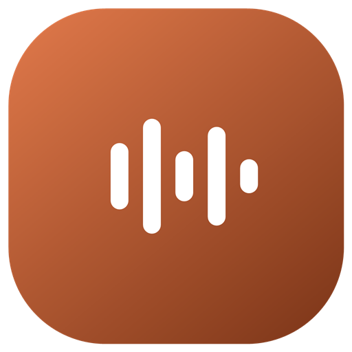
</p>

<h1 align="center">AudioBook Studio</h1>

<p align="center">
  <b>Turn your English manuscript into a full-cast audiobook, on your own computer.</b><br>
  A narrator and a fixed voice for every character, kept the same from the first chapter to the last.<br>
  No cloud, no account, no uploads.
</p>

<p align="center">
  
  
  
  
</p>

<p align="center">
  <a href="https://github.com/Blacke07/AudioBook-Studio-AI-TTS/releases/latest"><b>Download</b></a> ·
  <a href="#install-in-four-steps">Install</a> ·
  <a href="#your-first-audiobook">First audiobook</a> ·
  <a href="#ready-made-voices">Voices</a> ·
  <a href="#questions">FAQ</a>
</p>

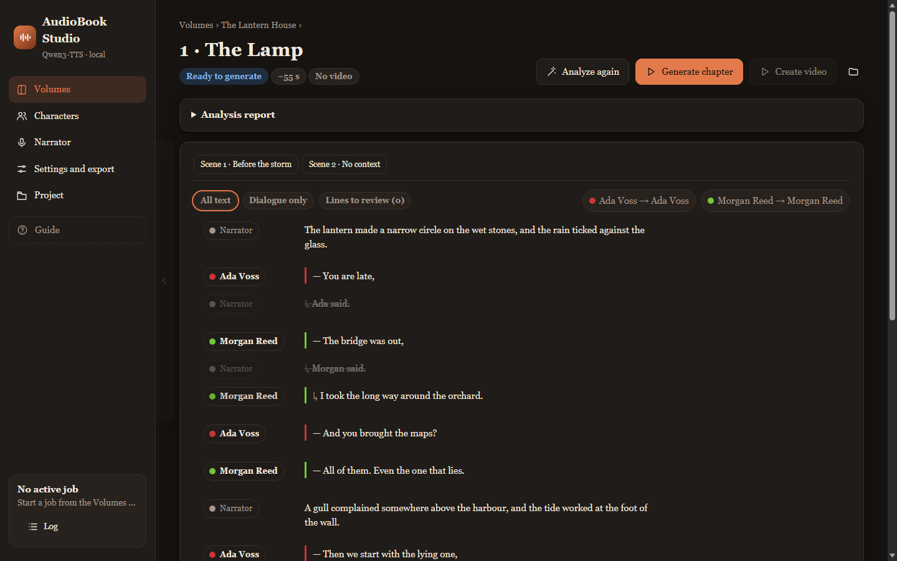

---

## What it does

| | |
| --- | --- |
| 📖 **Reads your chapters** | Point it at a folder of numbered `.txt` or `.docx` chapters. Your files are only read, never changed. |
| 🗣️ **Finds who is speaking** | A local AI model (Gemma) works out which character says each line. Anything uncertain waits for you instead of being guessed. |
| 🎙️ **One voice per character** | Describe a voice in plain English, listen to a few takes and **fix** the one you like. That character sounds the same in every chapter. |
| 🎧 **Ready-made voices** | Nine voices ship with the app: two narrators and seven characters. Pick one in a click and change it whenever you like. |
| 📦 **Exports a real audiobook** | WAV or MP3 per chapter, or a whole volume as one audiobook file with chapter markers. |
| 🎬 **Optional reading video** | Create an MP4 from existing chapter audio, with highlighted text, speaker names and scrolling context. Export YouTube chapter timestamps, too. |
| 💾 **Project backup and transfer** | Save settings, cast, fixed voices and speaker assignments in an `.abstudio` file. Preview imports, resolve conflicts and undo an import. |
| 🖥️ **Its own desktop window** | Launch from an EXE or shortcut, without browser tabs. Restore the existing window when launched again, and confirm before stopping active work. |
| 🔒 **Private by design** | Text, voices and audio stay on your computer. No telemetry, no sign-in, no online voice service. |
| 🧭 **Guided** | A short step-by-step guide opens the first time. Skip it, or reopen it anytime from **Guide**. |

## How it works

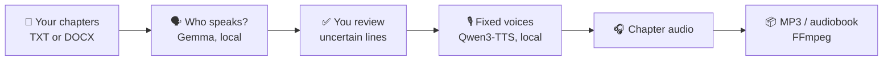

Everything in this chain runs on your machine. Internet is needed to download installation components
and models. The shared Microsoft WebView2 Runtime receives Microsoft's own updates; see [privacy](PRIVACY.md).

## New in the current build

- **Desktop window:** native title and icon, remembered size and position, notification-area controls,
  native Save dialogs and video previews. If the embedded browser crashes, work continues and the
  window can be reopened without restarting the server.
- **Reading videos:** create a chapter's MP4, batch selected chapters, or add video to automatic processing.
  Audio is reused, video has its own status, and interrupted renders leave completed chapters intact.
- **Project transfer:** export the parts you need, preview an import before writing anything, locate
  missing chapter folders and keep existing voices by default. Automatic backups support Undo.

The download has one stable name, **AudioBookStudio-Setup.exe**. New improvements replace the current
release; there is no sequence of V1/V2 downloads to choose between.

### The desktop window

The existing interface opens in its own application window. No browser address bar, tabs or personal
browser profile are used. Closing it checks for running or queued work before stopping the local server.

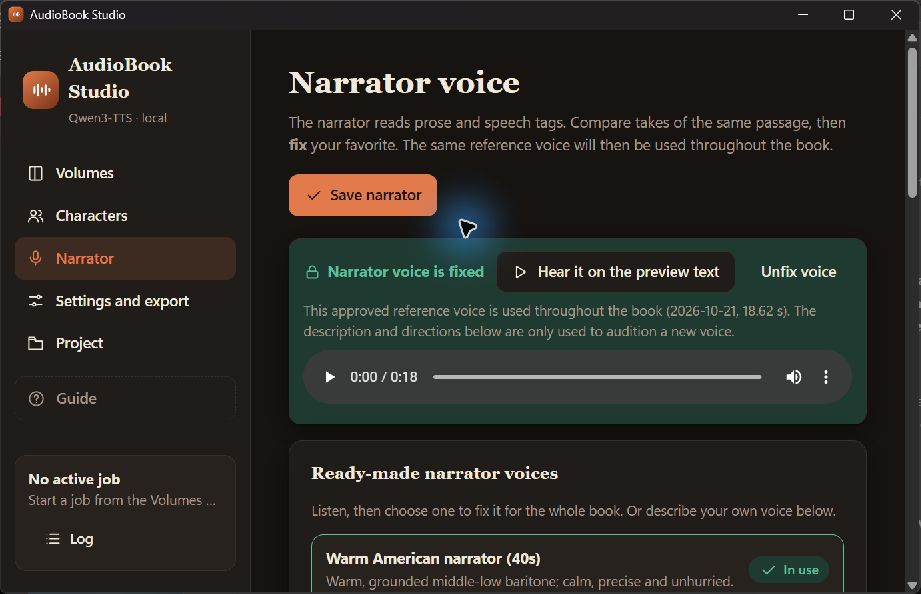

## A quick tour

### Your volume

Chapters, estimated length and status. One button runs everything: analyze, generate, export.

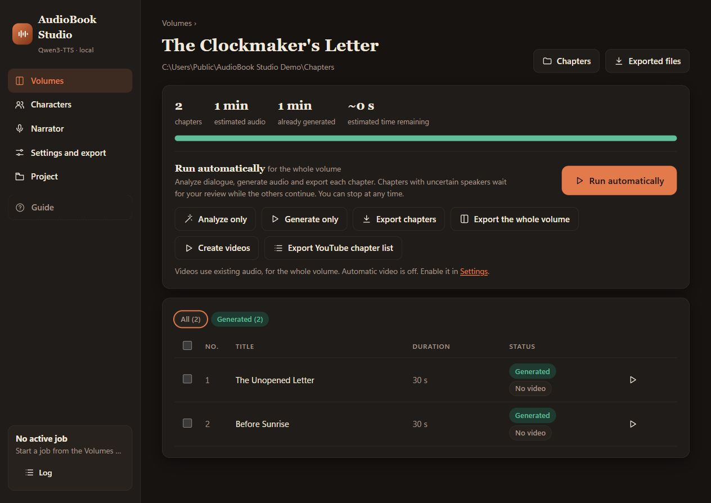

### The narrator

A warm narrator is fixed from the start. Listen to the alternatives or describe your own.

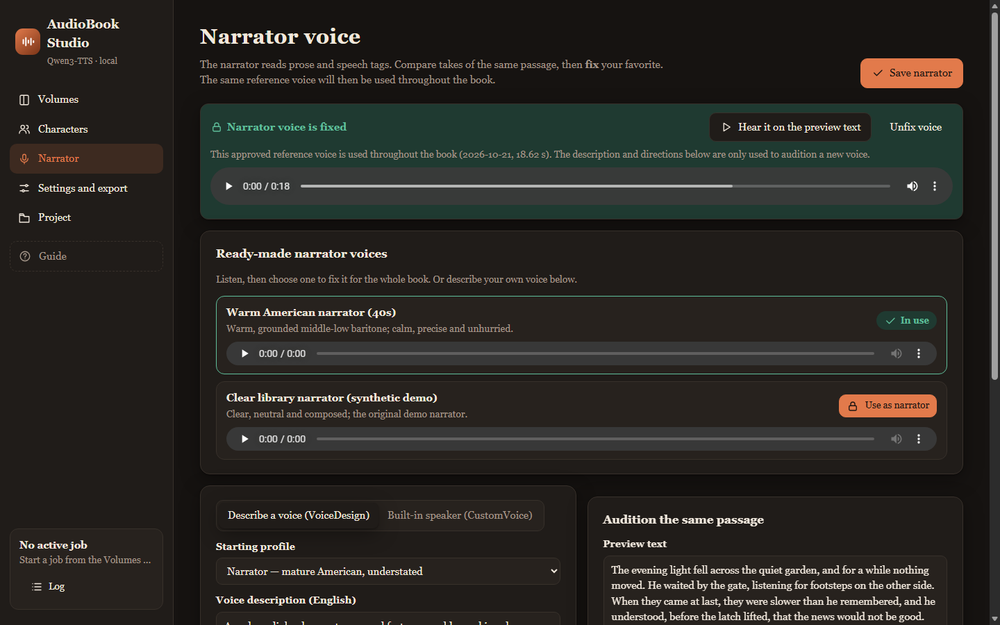

### Voices for your cast

Give any character a ready-made voice, or design a new one and fix your favorite take.

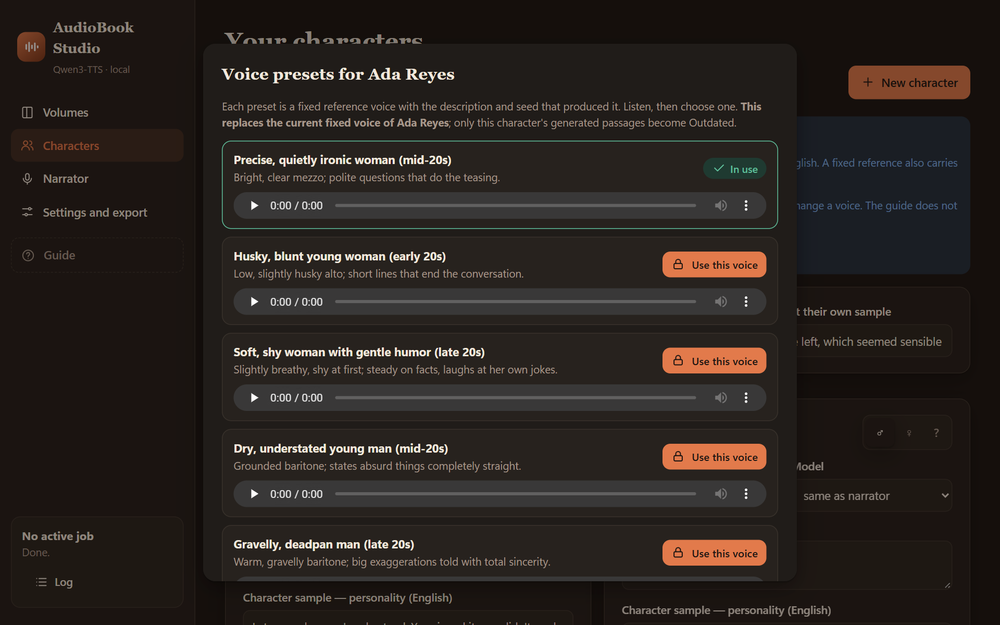

### The guide

Seven short steps from an empty app to your first chapter. Skip it or replay it anytime.

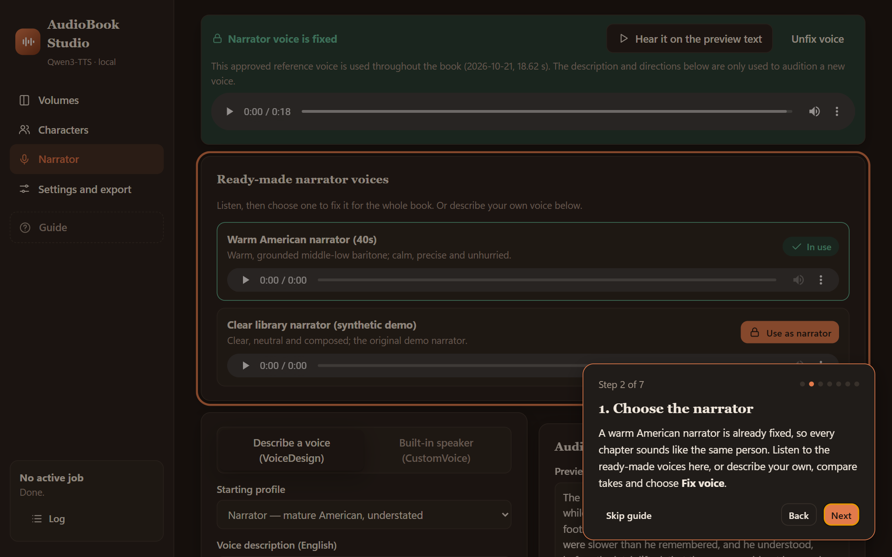

## Project backup and transfer

The **Project** page provides `.abstudio` import/export. Choose Settings, Cast and
fixed voices, or Volumes and speaker assignments separately. Open/Save use native Windows dialogs.
Preview shows additions, skipped items, settings differences and conflicts before anything is written.
Existing voices, characters and speaker corrections are kept by default. Settings are opt-in.

Missing chapter folders can be located in the preview. Scripts are skipped when the local chapter text
or the imported row text does not match. Network/device/relative sources from packages are skipped until
you locate an absolute local drive folder. Import creates a private backup; **Undo last import** restores the preceding state after
confirmation and first saves a safety backup of current edits. Stop the queue before transferring.

**Assignments include book text: do not share those packages publicly.** Voice-only exports contain
references and notes, but omit scripts and real-book audition examples. They can be used as voice packs;
review their contents first. Generated audio, models, caches and original manuscripts are never included.
Backups/reports remain local and are excluded from public source and installer packages.

See [project format and safeguards](docs/PROJECT_FORMAT.md) and [privacy](PRIVACY.md).
Installing the application and importing a project are separate steps.

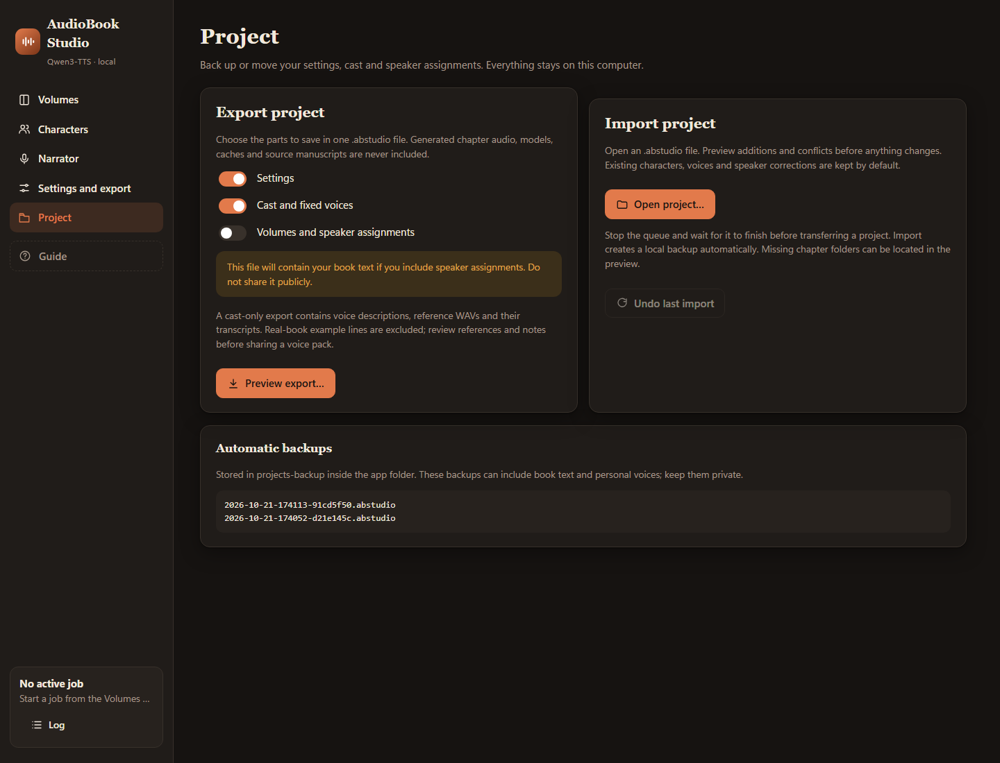

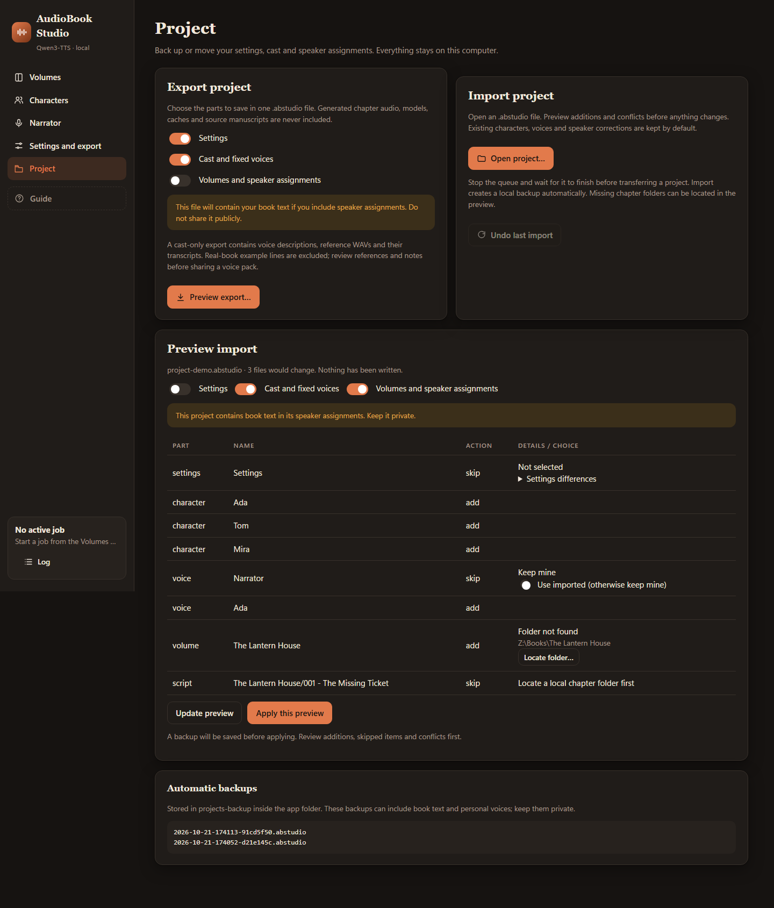

## Video (optional)

Create optional video for **audio that has already been generated**.
It highlights the current passage and speaker, with softly faded context and smooth transitions.
Automatic video is **off by default**; manual video creation is always available for current audio.

1. Open a generated chapter and choose **Create video**. Audio must be current.
2. Use **Open video** or **Show in folder** after it finishes. Video has its own ready/outdated status.
3. On a volume, **Create videos** processes the selection, or the whole volume when nothing is selected.
4. In **Settings and export → Video (optional)**, enable **Also create an MP4 video** to add video after
   audio export during **Run automatically**. Choose 1080p/720p, context, omitted tags, progress bar and footer.
5. **Export YouTube chapter list** saves timestamps beside the videos, using their actual MP4 durations.
   It requires current videos and assumes they will be joined in chapter order without gaps.

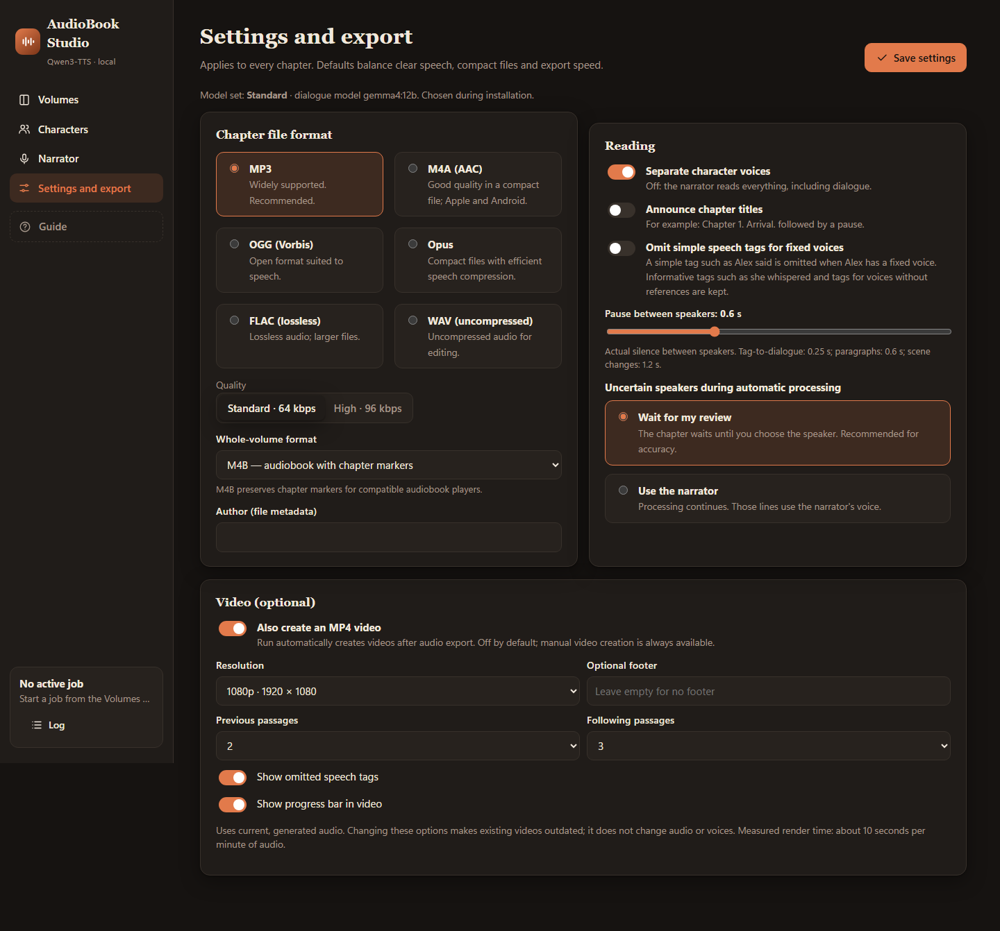

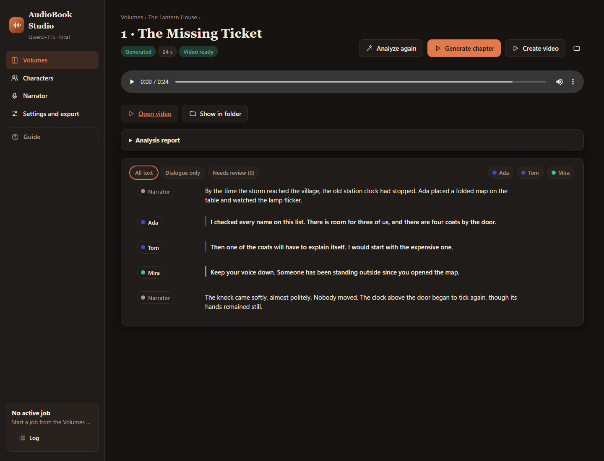

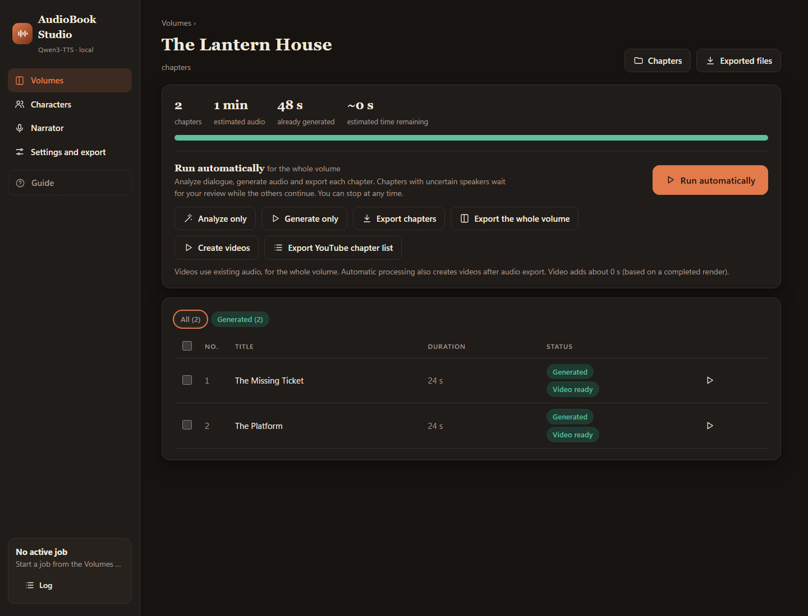

The same sequential worker handles audio and video. **Stop** cancels the current video; completed chapter
videos stay valid and are skipped when queued again. An unfinished chapter restarts its video render.
Valid videos are reused; changed audio, text, titles or appearance options make them outdated.
Turning automatic video on or off preserves current videos and measured timing. Video/audio durations
are checked against the chapter before a new MP4 replaces an old one. Videos are written atomically to
`export/<volume>/video/`. A video failure is reported separately and does not block other chapters' audio.
Time estimates appear only after a completed render with matching video settings. Full-volume MP4 joining
is not included yet; the whole-volume export button continues to export audio.

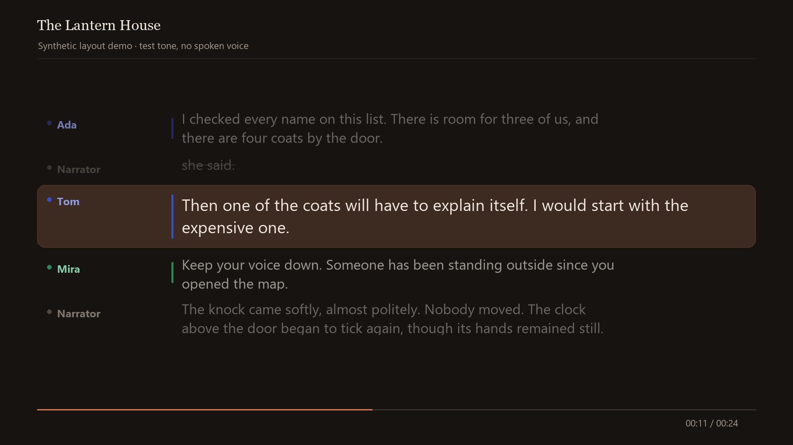

This is a synthetic layout preview with invented characters. Its local demonstration clip uses a test tone,
not a spoken or cloned voice. Your own video uses the existing chapter WAV, re-encoded as AAC.

The command-line renderer also remains available from the installation folder:

```powershell
.\.venv\Scripts\python.exe video.py "work\The Lantern House\001 - The Message" "export\chapter-video.mp4" --volume "The Lantern House"
```

Replace the example paths with your chapter work folder and a new MP4 filename. The work folder must contain
`script.json`, `audio.json` and `chapter.wav`. The output is 1080p, 30 fps, H.264/AAC with BT.709 colour tags.
Use `--start 0 --seconds 30` for a short preview, or omit them for the full chapter. Add `--hide-omitted`
to hide speech tags omitted from the audio. Existing output files are never overwritten.
Timing is at passage level; long passages scroll proportionally rather than tracking individual words.

## Install in four steps

1. **Download** [AudioBookStudio-Setup.exe](https://github.com/Blacke07/AudioBook-Studio-AI-TTS/releases/download/current/AudioBookStudio-Setup.exe)
   from the [current release](https://github.com/Blacke07/AudioBook-Studio-AI-TTS/releases/latest).
2. **Put it in an empty folder**, for example `D:\AudioBook Studio`. The app installs in that same folder.
   Use a local disk, not Program Files or the root of a drive.
3. **Open it and choose**:
   - the **model set**: **Standard** (12 GB graphics card, about 24 GB of models) or **Compact**
     (8 GB graphics card, about 12 GB, experimental). Setup picks the one that fits your card;
   - how to get the models: **Download the models for me** (needs internet), or **I already have the model files**:
     setup creates a `Local Models` folder and lists exactly what to put there.
4. **Click Install** and wait. When it says it is ready, click **Open AudioBook Studio**.
   Setup can add a desktop and Start menu shortcut for you.
   If Microsoft WebView2 Runtime is missing, setup asks before downloading and installing it.

**Setup: welcome.** Checks your graphics card and free space.

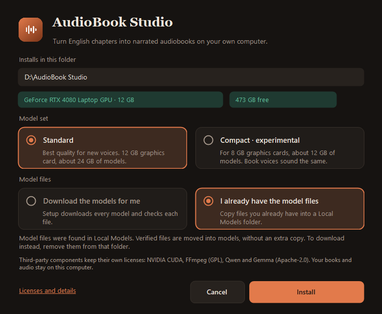

**Setup: progress.** Step-by-step progress with time left.

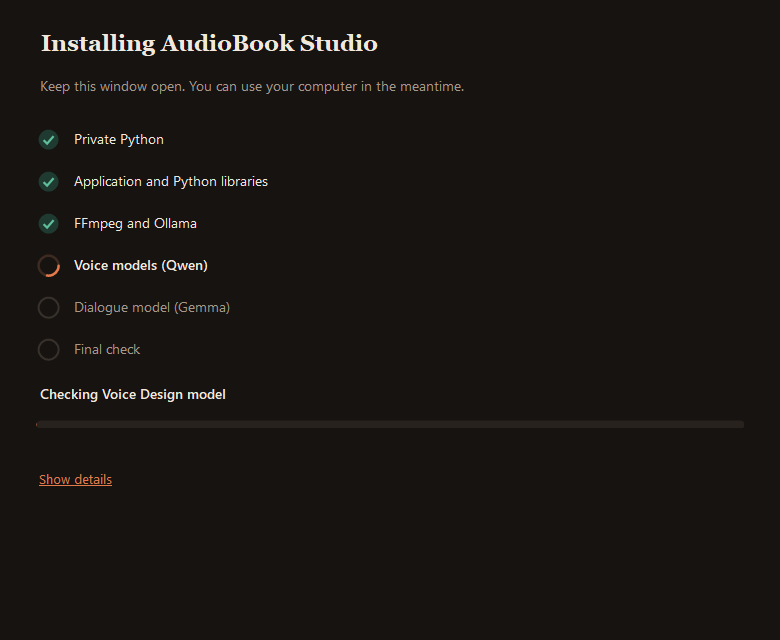

**Setup: finished.** Open the app and add shortcuts.

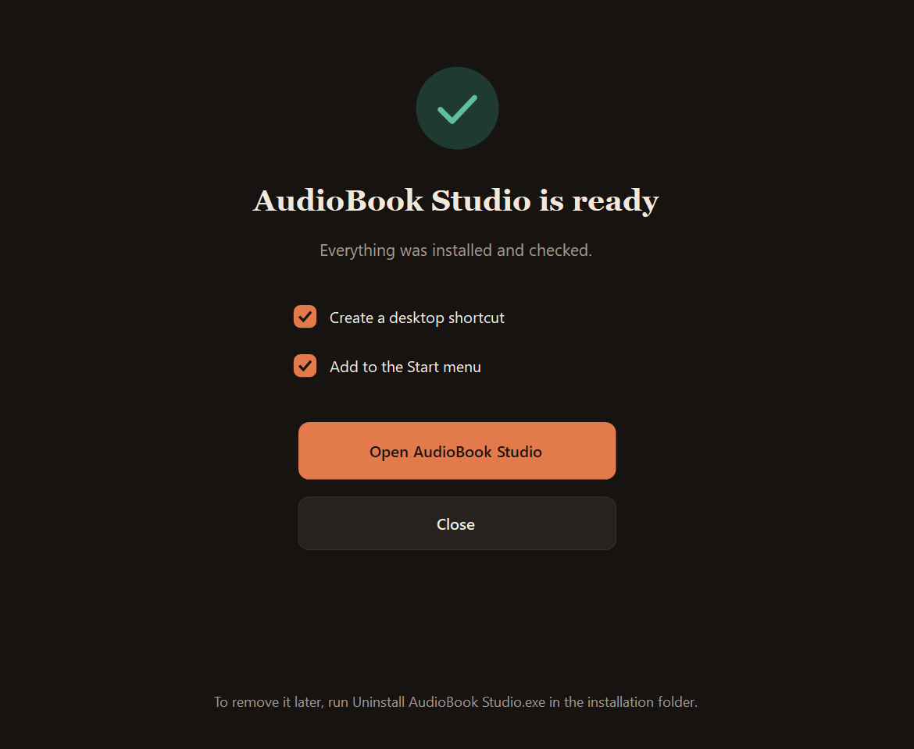

### What you need

| | Minimum for this version |
| --- | --- |
| System | Windows 10 or 11, 64-bit, CPU with AVX2 |
| Graphics card | NVIDIA RTX 20, 30, 40 or 50 series, driver 570.65 or newer.<br>**Standard: 12 GB VRAM.** Compact (experimental): 8 GB VRAM. See the hardware verification limits below. |
| Disk | Standard: **40 GB free** (models about 24 GB). Compact: **25 GB free** (models about 12 GB) |
| Memory | 32 GB RAM recommended |
| Internet | Only for the first installation |

The native engine is compiled for CUDA architectures 7.5, 8.0, 8.6, 8.9 and 12.0. Only one machine has been
tested physically (RTX 4080 Laptop, 12 GB); RTX 20/30/50 hardware remains untested. See
[VERIFICATION.md](VERIFICATION.md) for exactly what was checked. An RTX 3060 with 12 GB qualifies for Standard;
an RTX 2080 Ti with 11 GB qualifies only for experimental Compact. Cards with less than 8 GB are refused.

**One current download:** the release and its four assets are replaced together when improvements are
published. `SHA256SUMS.txt` belongs to the current files; save it with a download if you want to keep
that exact build. Internal installer and project-file format versions are separate compatibility markers.

### Standard or Compact?

| | **Standard** | **Compact** (experimental) |
| --- | --- | --- |
| Graphics card | 12 GB | 8 GB |
| Models to download | about 24 GB | about 12 GB |
| Reading your book with fixed voices | Qwen3-TTS Base | **the same model**, so the same voices |
| Designing a new voice | Qwen3-TTS, full precision | Qwen3-TTS, 8-bit (smaller) |
| Finding who speaks | Gemma 4 12B | Gemma 4 E4B (smaller) |

Fixed voices, including all the ready-made ones, sound the same in both. Compact may make auditions of new voices
sound slightly different, and its smaller dialogue model may leave more lines for you to review; uncertain lines are
never guessed silently. Compact has not been measured on an 8 GB card yet, which is why it is marked experimental.

<details>
<summary><b>What setup installs, and what it never touches</b></summary>

Setup installs a private Python runtime and `.venv`, pinned Python packages, the native Qwen engine, FFmpeg,
portable Ollama, four Qwen GGUF files and the exact Gemma dialogue model. Pinned downloads are checked by size and SHA-256.
It does not need Miniconda, PyTorch or a system Python, and it does not change your system PATH or Python.
Windows .NET Framework 4.x, PowerShell 5.1 and `tar.exe` must already be available (standard on supported Windows).

The installer refuses a folder that already holds another application. A failed installation can be retried in its
own folder after fixing the reported problem; it never silently replaces an existing app. Downloads are cached for a retry.
The shared Microsoft WebView2 Runtime is checked separately. If missing, setup asks before downloading
Microsoft's bootstrapper, verifies its Microsoft signature before execution and checks that the Runtime
became available. It is kept on uninstall. The release is not code-signed yet: compare the download with `SHA256SUMS.txt`.
</details>

<details>
<summary><b>Bring your own model files</b></summary>

Choose the model set, then **I already have the model files** and click **Create Local Models folder**. Setup creates
`Local Models` next to the EXE with a `_place models here` file listing every file that model set needs, its size,
SHA-256 and download link. Switching the model set in setup updates that list.

- Put the four exact `.gguf` files directly in `Local Models`.
- Put the exact pinned Gemma blobs in `Local Models/ollama/blobs/`
  (an existing Ollama keeps them in `%USERPROFILE%\.ollama\models\blobs`).

Then click **Check again** and **Install**. Setup copies and verifies the files and leaves your originals unchanged.
It is all or nothing: a missing or different file stops the installation with a clear message. A `Local Models` folder
that holds only the list means automatic download. Python, its packages, FFmpeg and Ollama still download automatically.
`python tools/model_list.py standard` (or `compact`) prints the same list.
</details>

## Your first audiobook

1. **Narrator.** A warm American narrator is already fixed. Keep it, pick the other ready-made narrator, or describe your own.
2. **Characters.** Add your cast. Click **Use a preset voice**, or describe a voice, listen and click **Fix**.
   The **Voice personality guide** has a complete prompt and a worked example.
3. **Volumes.** Add the folder with your chapters. Check the chapter order.
4. **Analyze.** The app assigns each line to a speaker. Review the lines it is unsure about and any new characters.
5. **Generate and export.** Listen to one chapter first, then run the whole volume. Work resumes where it stopped.

> [!TIP]
> Listen before long runs. Changing a fixed voice or the generation settings makes the affected passages
> **Outdated**, and only those are generated again.

## Ready-made voices

All of them were generated with Qwen3-TTS Voice Design. None is a recording of a real person.
Each one stores the description, delivery and seed that produced it ([`app/presets/presets.json`](app/presets/presets.json)).

| Voice | Use | Character |
| --- | --- | --- |
| **Warm American narrator (40s)** | narrator, default | Warm, grounded middle-low baritone; calm, precise and unhurried. |
| **Clear library narrator** | narrator | Clear, neutral and composed; the original demo narrator. |
| **Dry, understated young man** | character | Grounded baritone; states absurd things completely straight. |
| **Gravelly, deadpan man** | character | Warm, gravelly baritone; big exaggerations told with total sincerity. |
| **Smooth, courteous, guarded man** | character | Soft, velvety baritone; calm warmth that never raises its voice. |
| **Hoarse, gloomy drawl** | character | Lazy, slightly hoarse drawl; dark jokes delivered like weather reports. |
| **Precise, quietly ironic woman** | character | Bright, clear mezzo; polite questions that do the teasing. |
| **Husky, blunt young woman** | character | Low, slightly husky alto; short lines that end the conversation. |
| **Soft, shy woman with gentle humor** | character | Slightly breathy, shy at first; steady on facts, laughs at her own jokes. |

Using a preset works exactly like fixing a take you auditioned: you can edit, unfix or replace it later.
The narrator starts at temperature **0.55** and seed **42**. Temperature controls how much each take varies;
the seed makes a take repeatable. The fixed reference recording is what keeps the voice recognizable.

## Your data stays yours

- Books, voices and audio stay on your computer. There are no analytics and no cloud voice service.
- Your manuscripts are only read. Removing a volume from the app does not delete the original files.
- The server answers only this computer's own browser page (`127.0.0.1` / `localhost`) and refuses requests from
  other websites. Do not expose it to a network.
- Installation downloads software and models from GitHub, PyPI, Hugging Face and the Ollama registry.
  Details in [PRIVACY.md](PRIVACY.md).

## Uninstall

Close the app, then run **Uninstall AudioBook Studio.exe** in the installation folder. It removes what setup installed:
the application, its private Python, the engine, FFmpeg, Ollama, the models and the shortcuts it created.
Your settings, characters, fixed voices, generated audio and exports are **kept** unless you choose to delete them.
Your manuscripts, `Local Models`, the setup EXE and anything else you put in the folder are never touched.
The download cache in `%LOCALAPPDATA%/AudioBookStudio-Installer` can be deleted separately.

## Questions

<details>
<summary><b>Does it work without an NVIDIA graphics card, or with less than 12 GB?</b></summary>

The voice engine is built for NVIDIA RTX 20, 30, 40 and 50 series cards. With 8 GB of video memory, choose the
**Compact** model set during setup; it is experimental until it has been measured on an 8 GB card.
Other GPU brands and CUDA architectures not listed above are not accepted by this build.
</details>

<details>
<summary><b>Can I use books in other languages?</b></summary>

The app, its voices and the dialogue analysis are made and tested for English text.
</details>

<details>
<summary><b>Will a character always get the right voice?</b></summary>

The app assigns lines it is sure about and asks you about the rest, but AI speaker attribution can be wrong.
Check the analysis, especially in long dialogues. Voice similarity checks are a help, not a guarantee: listen.
</details>

<details>
<summary><b>Can I move the app to another folder or computer?</b></summary>

Keep it in the folder where you installed it; its Python environment is tied to that location.
For another place or computer, export an `.abstudio` package from **Project**, install into a new folder,
then use **Project → Open project** there. Review the preview and explicitly choose any settings or voice
replacements. Manuscripts are not inside the package: make them available separately and use **Locate folder**
if their paths differ. Generated audio and models are not transferred by project export. Keep the old
installation until you have checked the new one; setup does not overwrite an existing installation.
</details>

<details>
<summary><b>Which ports does it use?</b></summary>

The interface opens at `http://127.0.0.1:7863/`. The voice engine uses 7864 and dialogue analysis uses Ollama on 11434.
An Ollama that is already running is reused only if it has the exact pinned Gemma model.
`AudioBook Studio.exe` opens its own window, using Microsoft WebView2. There are no browser tabs or
address bar, and your normal browser profile is not used. Close the application window to stop its
local server and owned child processes. If work is running or queued, choose **Cancel** to continue or
**Stop and exit** to quit. A notification-area icon provides **Show window**, **Open startup log**, and
**Stop and exit**. Starting the same installation again brings its existing window forward.
If the embedded browser crashes, local jobs keep running. Choose **Reopen window** to restore the
interface; choosing to exit still checks for running or queued work before stopping the server.

The window remembers its size and position. Video previews open in owned application windows;
downloads use a native Save dialog. A dedicated WebView2 profile and window placement live under
`.desktop` inside the installation and are removed by the uninstaller. The shared Microsoft WebView2
Runtime is kept. If it is missing, setup asks before downloading and installing it from Microsoft;
you can instead install it yourself from [Microsoft's WebView2 page](https://developer.microsoft.com/microsoft-edge/webview2/).
Running `app.py` directly for development still opens the normal browser.

</details>

## Testing and limitations

> [!NOTE]
> This is a personal project, tested on one Windows computer with an NVIDIA RTX 4080 Laptop (12 GB).
> Automated checks and local audio tests have passed, but they do not guarantee that every feature will work
> on every computer. RTX 20/30/50 cards are included as build targets and have not been tested on physical hardware.
> Compact remains experimental: its real-model memory use, speed, dialogue accuracy and voice quality have
> not been measured on an 8 GB card. Installation on a clean Windows system and full uninstallation still
> need validation. The installer is unsigned.
> The missing-WebView2 download/install path, taskbar grouping on other Windows systems and closing a real
> long generation from the desktop window remain unverified. Browser-crash recovery and busy/queued exit
> handling were tested with a fake backend, without running models.

The current build passed **206 Python tests and 8 Node tests**, including tests run from the packaged source.
This is an early release with the testing limits above. [VERIFICATION.md](VERIFICATION.md) describes the checks performed
and their limits. Please review speaker assignments and listen to a sample chapter before running a whole book.
If you find a problem, reports with your GPU, Windows version and steps to reproduce are welcome in
[Issues](https://github.com/Blacke07/AudioBook-Studio-AI-TTS/issues). Please leave out private manuscripts,
personal audio and other sensitive information.

## For developers

The repository contains the app, the installer and uninstaller, tests, the voice presets and assets.
Models, downloaded runtimes, build output and user data are not stored in Git.
See [docs/BUILD.md](docs/BUILD.md) for a repeatable Windows build.
Each release includes the exact native engine source in `AudioBookStudio-native-source.zip`.

Everyone is welcome to try the build, fork the repository and customize it to suit their own workflow.
You are welcome to share your improvements, too. Please keep the MIT license notice and respect the
separate licenses of the models and third-party components when redistributing your version.

## License and credits

The app's own code is [MIT-licensed](LICENSE). Models and third-party components keep their own licenses:
Qwen3-TTS and Gemma 4 (Apache-2.0), the native engine (MIT), NVIDIA CUDA terms and FFmpeg (GPL).
See [THIRD_PARTY_NOTICES.md](THIRD_PARTY_NOTICES.md) and `licenses/` before redistributing anything.

Use only texts and reference voices you have the right to use. The app does not grant rights to source material.

<sub>This build was developed and tested with assistance from Opus 5.5 and GPT 6.1-Sol. Errors may remain;
AI-assisted development and automated tests do not replace independent testing.</sub>
