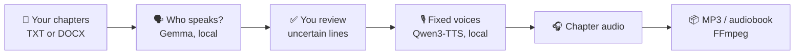

  

<h1 align="center">AudioBook Studio</h1>

  <b>Turn your English manuscript into a full-cast audiobook, on your own computer.</b> 
  A narrator and a fixed voice for every character, kept the same from the first chapter to the last. 
  No cloud, no account, no uploads.

  
  
  
  
  

  <a href="https://github.com/Blacke07/AudioBook-Studio-AI-TTS/releases"><b>Download</b></a> ·
  <a href="#install-in-four-steps">Install</a> ·
  <a href="#your-first-audiobook">First audiobook</a> ·
  <a href="#ready-made-voices">Voices</a> ·
  <a href="#questions">FAQ</a>

---

## What it does

| | |
| --- | --- |
| 📖 **Reads your chapters** | Point it at a folder of numbered `.txt` or `.docx` chapters. Your files are only read, never changed. |
| 🗣️ **Finds who is speaking** | A local AI model (Gemma) works out which character says each line. Anything uncertain waits for you instead of being guessed. |
| 🎙️ **One voice per character** | Describe a voice in plain English, listen to a few takes and **fix** the one you like. That character sounds the same in every chapter. |
| 🎧 **Ready-made voices** | Nine voices ship with the app: two narrators and seven characters. Pick one in a click and change it whenever you like. |
| 📦 **Exports a real audiobook** | WAV or MP3 per chapter, or a whole volume as one audiobook file with chapter markers. |
| 🔒 **Private by design** | Text, voices and audio stay on your computer. No telemetry, no sign-in, no online voice service. |
| 🧭 **Guided** | A short step-by-step guide opens the first time. Skip it, or reopen it anytime from **Guide**. |

## How it works

Everything in this chain runs on your machine. Internet is only needed once, to install.

## A quick tour

### Your volume

Chapters, estimated length and status. One button runs everything: analyze, generate, export.

### The narrator

A warm narrator is fixed from the start. Listen to the alternatives or describe your own.

### Voices for your cast

Give any character a ready-made voice, or design a new one and fix your favorite take.

### The guide

Seven short steps from an empty app to your first chapter. Skip it or replay it anytime.

## Install in four steps

1. **Download** `AudioBookStudio-Setup-1.0.0.exe` from the [Releases page](https://github.com/Blacke07/AudioBook-Studio-AI-TTS/releases).
2. **Put it in an empty folder**, for example `D:\AudioBook Studio`. The app installs in that same folder.
   Use a local disk, not Program Files or the root of a drive.
3. **Open it and choose**:
   - the **model set**: **Standard** (12 GB graphics card, about 24 GB of models) or **Compact**
     (8 GB graphics card, about 12 GB, experimental). Setup picks the one that fits your card;
   - how to get the models: **Download the models for me** (needs internet), or **I already have the model files**:
     setup creates a `Local Models` folder and lists exactly what to put there.
4. **Click Install** and wait. When it says it is ready, click **Open AudioBook Studio**.
   Setup can add a desktop and Start menu shortcut for you.

**Setup: welcome.** Checks your graphics card and free space.

**Setup: progress.** Step-by-step progress with time left.

**Setup: finished.** Open the app and add shortcuts.

### What you need

| | Minimum for this version |
| --- | --- |
| System | Windows 10 or 11, 64-bit, CPU with AVX2 |
| Graphics card | NVIDIA RTX 20, 30, 40 or 50 series, driver 570.65 or newer. **Standard: 12 GB VRAM.** Compact (experimental): 8 GB VRAM. See the hardware verification limits below. |
| Disk | Standard: **40 GB free** (models about 24 GB). Compact: **25 GB free** (models about 12 GB) |
| Memory | 32 GB RAM recommended |
| Internet | Only for the first installation |

The native engine is compiled for CUDA architectures 7.5, 8.0, 8.6, 8.9 and 12.0. Only one machine has been
tested physically (RTX 4080 Laptop, 12 GB); RTX 20/30/50 hardware remains untested. See
[VERIFICATION.md](VERIFICATION.md) for exactly what was checked. An RTX 3060 with 12 GB qualifies for Standard;
an RTX 2080 Ti with 11 GB qualifies only for experimental Compact. Cards with less than 8 GB are refused.

**Release note:** expanded GPU targets start with `v1.0.0-rc.2`. The first published package,
`v1.0.0-rc.1`, retains the older architecture-8.9 build.

### Standard or Compact?

| | **Standard** | **Compact** (experimental) |
| --- | --- | --- |
| Graphics card | 12 GB | 8 GB |
| Models to download | about 24 GB | about 12 GB |
| Reading your book with fixed voices | Qwen3-TTS Base | **the same model**, so the same voices |
| Designing a new voice | Qwen3-TTS, full precision | Qwen3-TTS, 8-bit (smaller) |
| Finding who speaks | Gemma 4 12B | Gemma 4 E4B (smaller) |

Fixed voices, including all the ready-made ones, sound the same in both. Compact may make auditions of new voices
sound slightly different, and its smaller dialogue model may leave more lines for you to review; uncertain lines are
never guessed silently. Compact has not been measured on an 8 GB card yet, which is why it is marked experimental.

<b>What setup installs, and what it never touches</b>

Setup installs a private Python runtime and `.venv`, pinned Python packages, the native Qwen engine, FFmpeg,
portable Ollama, four Qwen GGUF files and the exact Gemma dialogue model. Every file is checked by size and SHA-256.
It does not need Miniconda, PyTorch or a system Python, and it does not change your system PATH or Python.
Windows .NET Framework 4.x, PowerShell 5.1 and `tar.exe` must already be available (standard on supported Windows).

The installer refuses a folder that already holds another application. A failed installation can be retried in its
own folder after fixing the reported problem; it never silently replaces an existing app. Downloads are cached for a retry.
The release is not code-signed yet: compare the download with `SHA256SUMS.txt`.

<b>Bring your own model files</b>

Choose the model set, then **I already have the model files** and click **Create Local Models folder**. Setup creates
`Local Models` next to the EXE with a `_place models here` file listing every file that model set needs, its size,
SHA-256 and download link. Switching the model set in setup updates that list.

- Put the four exact `.gguf` files directly in `Local Models`.
- Put the exact pinned Gemma blobs in `Local Models/ollama/blobs/`
  (an existing Ollama keeps them in `%USERPROFILE%\.ollama\models\blobs`).

Then click **Check again** and **Install**. Setup copies and verifies the files and leaves your originals unchanged.
It is all or nothing: a missing or different file stops the installation with a clear message. A `Local Models` folder
that holds only the list means automatic download. Python, its packages, FFmpeg and Ollama still download automatically.
`python tools/model_list.py standard` (or `compact`) prints the same list.

## Your first audiobook

1. **Narrator.** A warm American narrator is already fixed. Keep it, pick the other ready-made narrator, or describe your own.
2. **Characters.** Add your cast. Click **Use a preset voice**, or describe a voice, listen and click **Fix**.
   The **Voice personality guide** has a complete prompt and a worked example.
3. **Volumes.** Add the folder with your chapters. Check the chapter order.
4. **Analyze.** The app assigns each line to a speaker. Review the lines it is unsure about and any new characters.
5. **Generate and export.** Listen to one chapter first, then run the whole volume. Work resumes where it stopped.

> [!TIP]
> Listen before long runs. Changing a fixed voice or the generation settings makes the affected passages
> **Outdated**, and only those are generated again.

## Ready-made voices

All of them were generated with Qwen3-TTS Voice Design. None is a recording of a real person.
Each one stores the description, delivery and seed that produced it ([`app/presets/presets.json`](app/presets/presets.json)).

| Voice | Use | Character |
| --- | --- | --- |
| **Warm American narrator (40s)** | narrator, default | Warm, grounded middle-low baritone; calm, precise and unhurried. |
| **Clear library narrator** | narrator | Clear, neutral and composed; the original demo narrator. |
| **Dry, understated young man** | character | Grounded baritone; states absurd things completely straight. |
| **Gravelly, deadpan man** | character | Warm, gravelly baritone; big exaggerations told with total sincerity. |
| **Smooth, courteous, guarded man** | character | Soft, velvety baritone; calm warmth that never raises its voice. |
| **Hoarse, gloomy drawl** | character | Lazy, slightly hoarse drawl; dark jokes delivered like weather reports. |
| **Precise, quietly ironic woman** | character | Bright, clear mezzo; polite questions that do the teasing. |
| **Husky, blunt young woman** | character | Low, slightly husky alto; short lines that end the conversation. |
| **Soft, shy woman with gentle humor** | character | Slightly breathy, shy at first; steady on facts, laughs at her own jokes. |

Using a preset works exactly like fixing a take you auditioned: you can edit, unfix or replace it later.
The narrator starts at temperature **0.55** and seed **42**. Temperature controls how much each take varies;
the seed makes a take repeatable. The fixed reference recording is what keeps the voice recognizable.

## Your data stays yours

- Books, voices and audio stay on your computer. There are no analytics and no cloud voice service.
- Your manuscripts are only read. Removing a volume from the app does not delete the original files.
- The server answers only this computer's own browser page (`127.0.0.1` / `localhost`) and refuses requests from
  other websites. Do not expose it to a network.
- Installation downloads software and models from GitHub, PyPI, Hugging Face and the Ollama registry.
  Details in [PRIVACY.md](PRIVACY.md).

## Uninstall

Close the app, then run **Uninstall AudioBook Studio.exe** in the installation folder. It removes what setup installed:
the application, its private Python, the engine, FFmpeg, Ollama, the models and the shortcuts it created.
Your settings, characters, fixed voices, generated audio and exports are **kept** unless you choose to delete them.
Your manuscripts, `Local Models`, the setup EXE and anything else you put in the folder are never touched.
The download cache in `%LOCALAPPDATA%/AudioBookStudio-Installer` can be deleted separately.

## Questions

<b>Does it work without an NVIDIA graphics card, or with less than 12 GB?</b>

The voice engine is built for NVIDIA RTX 20, 30, 40 and 50 series cards. With 8 GB of video memory, choose the
**Compact** model set during setup; it is experimental until it has been measured on an 8 GB card.
Other GPU brands and CUDA architectures not listed above are not accepted by this build.

<b>Can I use books in other languages?</b>

The app, its voices and the dialogue analysis are made and tested for English text.

<b>Will a character always get the right voice?</b>

The app assigns lines it is sure about and asks you about the rest, but AI speaker attribution can be wrong.
Check the analysis, especially in long dialogues. Voice similarity checks are a help, not a guarantee: listen.

<b>Can I move the app to another folder or computer?</b>

Keep it in the folder where you installed it; its Python environment is tied to that location.
For another place or computer, install again there and copy your own settings and voices over deliberately.

<b>Which ports does it use?</b>

The interface opens at `http://127.0.0.1:7863/`. The voice engine uses 7864 and dialogue analysis uses Ollama on 11434.
An Ollama that is already running is reused only if it has the exact pinned Gemma model.
Keep the launcher window open; closing it stops the app.

## Testing and limitations

> [!NOTE]
> This is a personal project, tested on one Windows computer with an NVIDIA RTX 4080 Laptop (12 GB).
> Automated checks and local audio tests have passed, but they do not guarantee that every feature will work
> on every computer. RTX 20/30/50 cards are included as build targets and have not been tested on physical hardware.
> Compact remains experimental: its real-model memory use, speed, dialogue accuracy and voice quality have
> not been measured on an 8 GB card. Installation on a clean Windows system and full uninstallation still
> need validation. The installer is unsigned.

Version 1.0.0 remains a release candidate. [VERIFICATION.md](VERIFICATION.md) describes the checks performed
and their limits. Please review speaker assignments and listen to a sample chapter before running a whole book.
If you find a problem, reports with your GPU, Windows version and steps to reproduce are welcome in
[Issues](https://github.com/Blacke07/AudioBook-Studio-AI-TTS/issues). Please leave out private manuscripts,
personal audio and other sensitive information.

## For developers

The repository contains the app, the installer and uninstaller, tests, the voice presets and assets.
Models, downloaded runtimes, build output and user data are not stored in Git.
See [docs/BUILD.md](docs/BUILD.md) for a repeatable Windows build.
Each release includes the exact native engine source in `AudioBookStudio-native-source.zip`.

Everyone is welcome to try the build, fork the repository and customize it to suit their own workflow.
You are welcome to share your improvements, too. Please keep the MIT license notice and respect the
separate licenses of the models and third-party components when redistributing your version.

## License and credits

The app's own code is [MIT-licensed](LICENSE). Models and third-party components keep their own licenses:
Qwen3-TTS and Gemma 4 (Apache-2.0), the native engine (MIT), NVIDIA CUDA terms and FFmpeg (GPL).
See [THIRD_PARTY_NOTICES.md](THIRD_PARTY_NOTICES.md) and `licenses/` before redistributing anything.

Use only texts and reference voices you have the right to use. The app does not grant rights to source material.

This build was developed and tested with assistance from Opus 5.5 and GPT 6.1-Sol. Errors may remain;
AI-assisted development and automated tests do not replace independent testing.
